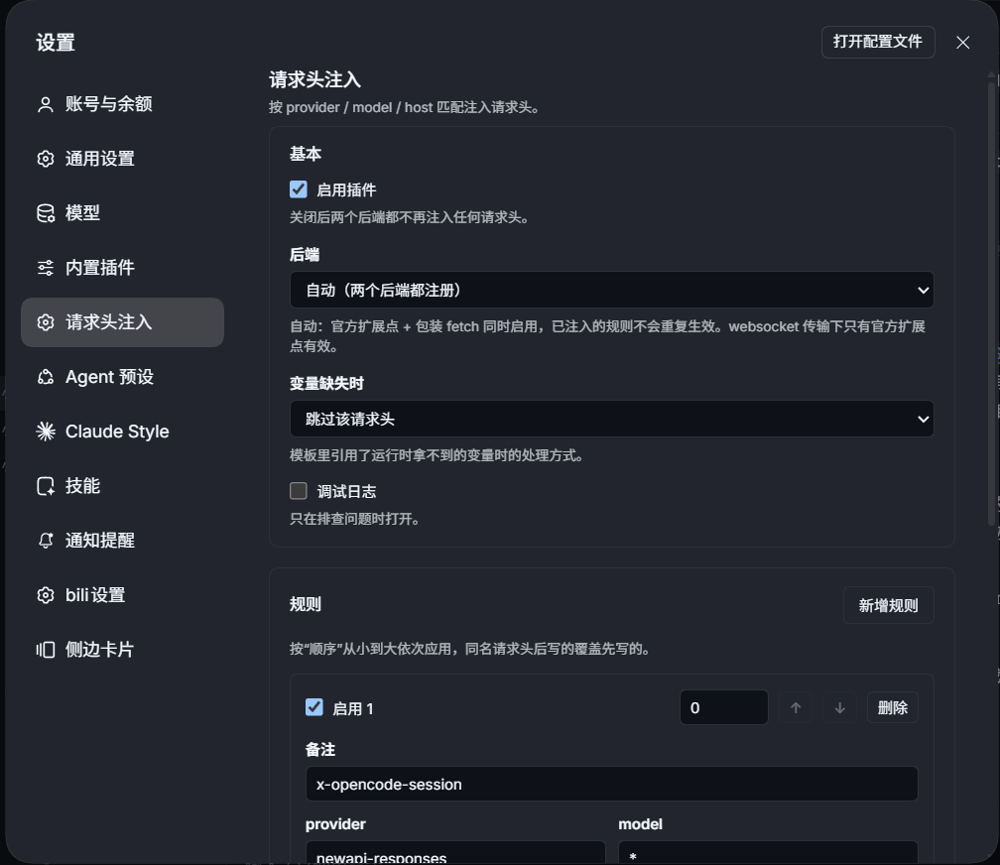
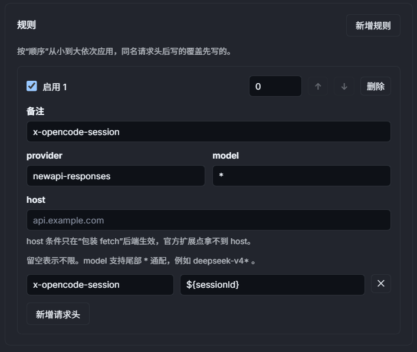
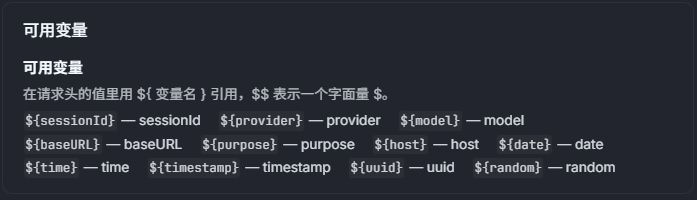
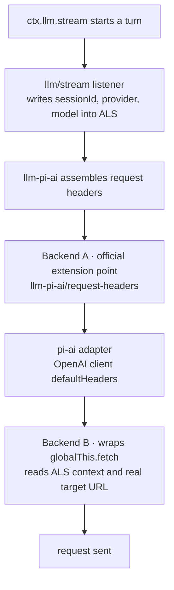
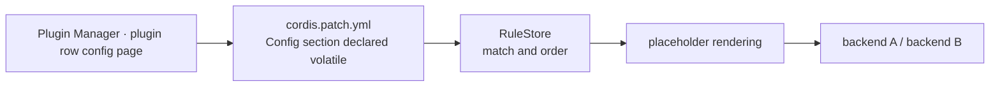

# dsh-request-injector

A DSH (DeepSeek Harness) plugin that injects custom HTTP headers into downstream model requests, matched by provider / model / host. Header values may contain `${variable}` placeholders, evaluated only when the request is actually sent.

Typical uses: attaching a session header to a self-hosted gateway, tagging per-model tenants, or carrying trace headers — things that would otherwise require patching DSH itself or hardcoding logic in the gateway.

## Screenshots

The config page (Settings → "Request headers") holds the basic settings, the rule cards and the variable quick-reference card. The same configuration is also reachable from Plugin Manager → the "dsh-request-injector" row detail; both entries read and write the same namespace.

<!-- screenshot slot: place the image at docs/images/plugin-config.png -->


<!-- screenshot slot: place the image at docs/images/plugin-rule-card.png (expanded rule, match fields and header rows) -->


<!-- screenshot slot: place the image at docs/images/plugin-variables.png (available variables table) -->


## Architecture



The plugin hooks into two points on this path because neither backend covers everything on its own:

| Backend | Covers | Blind spot |
| --- | --- | --- |
| A · extension point | every transport of the pi-ai adapter, websocket included | cannot see the real target URL; non-pi-ai adapters such as `llm-deepseek` and model-listing never reach it |
| B · fetch wrapper | every path that goes through `globalThis.fetch`, with exact host matching | the websocket handshake does not go through fetch |

The default `backend: auto` enables both: rules already injected by backend A are recorded in that request's context and skipped by backend B, so nothing is written twice.

## Configuration flow



The config section is declared volatile: saving in the plugin page takes effect on the next request, with no plugin restart and no DSH reload. You can also hand-edit the profile's `cordis.patch.yml`; the host half audits such hand-written config once and logs obvious mistakes.

## Features

- Three match dimensions: `provider` exact, `model` exact or prefix with a trailing `*`, `host` against the real target host
- Placeholders in header values, e.g. `x-opencode-session: ${sessionId}`, `x-trace-id: ${uuid}`; no recursive expansion, `$$` emits a literal `$`
- Missing-variable policy `skip` (drop the header) / `empty` (substitute an empty string) / `error` (fail the request)
- Two selectable injection backends, de-duplicated per rule under `auto`
- Visual form in the plugin page: add/remove/reorder rules, per-header validation, a variable quick-reference card, whole-config submission with revision conflict detection
- Reserved-header protection: headers owned by the HTTP stack or the host (`authorization`, `host`, `content-length`, `x-dsh-*`, …) are refused

## Installation

```
dsh plugin install github:PluieM/dsh-request-injector
```

Or use "Add plugin" in Plugin Manager with `github:PluieM/dsh-request-injector`. The package ships prebuilt `lib/index.js` (host) and `lib/client.js` (web client); no build step is required.

## Quick start

Everything is configured in the UI; no file editing is required.

1. Open Plugin Manager, find the "Request Header Injector" row and open its config page.
2. Adjust the **Basics** card as needed: the **Enable plugin** toggle, **Backend** (defaults to "Auto (both backends)"), the **missing-variable** policy, and the **debug logging** switch.
3. In the **Rules** card click "Add rule" and fill in:
   - **Match**: `provider`, `model`, `host` — empty means any; `model` accepts a trailing `*`, e.g. `deepseek-v4*`
   - **Headers**: click "Add header" and fill in name and value; values may contain placeholders such as `${sessionId}`
   - **Order**: lower numbers apply first; a later write overrides an earlier one for the same header name. Both rules and headers can be reordered with "Move up" / "Move down"
   - **Comment**: an optional note describing the rule
4. Click "Save". Saving takes effect immediately — the next request carries the headers, with no plugin or DSH restart.

The form validates each header before submitting: illegal names and reserved headers are flagged inline. Saving submits the whole config at once; if the config was changed elsewhere in the meantime, a conflict is reported and you must "Revert" before saving again. The footer shows "unsaved changes / saved" state live.

Right after installation nothing is injected (`rules` is empty), so existing behaviour is untouched. Per-variable availability and per-backend visibility are listed on the "Available variables" card at the bottom of the config page.

### Hand-written configuration (optional)

When the UI does not fit — batch provisioning by script, keeping config under version control — you can edit the profile's `cordis.patch.yml` directly. The host half audits it on load and on every hot update, and logs obvious mistakes:

```yaml
enabled: true
backend: auto            # auto | headers | fetch
onMissingVariable: skip  # skip | empty | error
debug: false
rules:
  - enabled: true
    comment: session header for the gateway
    match:
      provider: newapi-responses
      model: ''          # empty = any
      host: ''           # empty = any
    headers:
      x-opencode-session: ${sessionId}
```

## Layout

```
lib/index.js             host entry (apply / name / Config / config audit)
lib/schema.js            Config definition (whole section volatile) and normalizeConfig
lib/rules.js             rule matching, reserved-header check
lib/template.js          placeholder rendering
lib/context.js           AsyncLocalStorage request context (wraps the llm/stream iterator)
lib/backend-headers.js   backend A: llm-pi-ai/request-headers extension point
lib/backend-fetch.js     backend B: globalThis.fetch wrapper
lib/log.js               logging with a debug switch and de-duplication
lib/client.js            web client bundle (hand-written CJS, form and both locales inline)
test/unit                unit tests; test/integration holds end-to-end cases
```

## Development

```bash
npm test     # node --test --experimental-test-isolation=none test/
npm run lint # node --check per file
```

`--experimental-test-isolation=none` keeps tests in-process: the local sandbox forbids spawning one process per test file.

## Known limitations

- **With websocket transport only backend A works.** The pi-ai WS handshake takes headers straight from the OpenAI client's `defaultHeaders` and never goes through `globalThis.fetch`, so backend B is silently ineffective there. Keeping the default `backend: auto` avoids it.
- **Configuration is stored in clear text in the profile's `cordis.patch.yml`.** Do not put long-lived secrets here; prefer short-lived session IDs.
- Model names are typed by hand; there is no model picker.
- Only headers are modified, never request bodies.

## Documentation

- Changelog: [CHANGELOG.md](CHANGELOG.md)

## License

MIT
