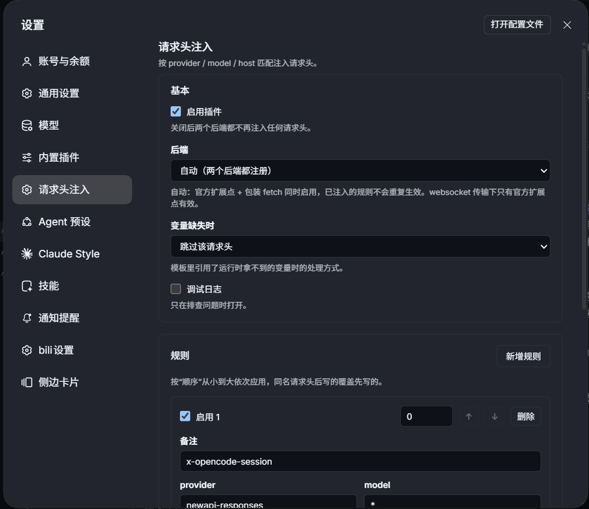
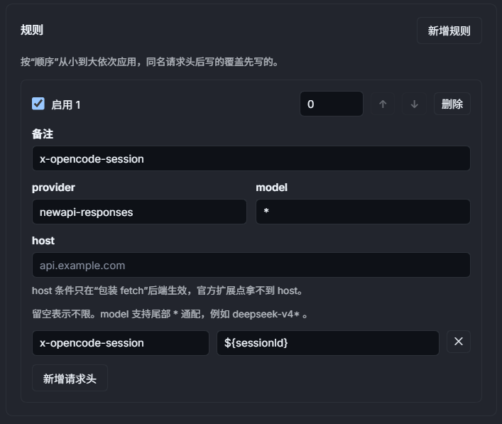
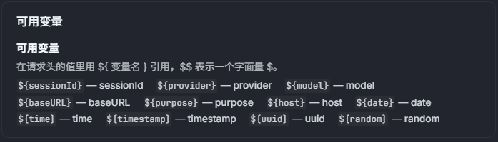
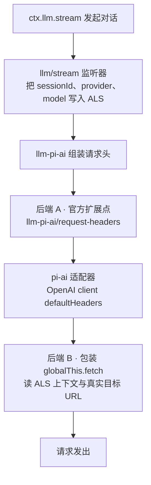
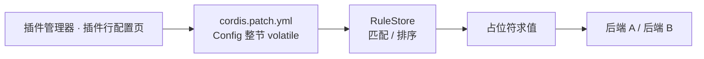

# dsh-request-injector

一个 DSH（DeepSeek Harness）插件：按 provider / model / host 匹配，向下游模型请求注入自定义 HTTP 请求头。请求头的值支持 `${变量}` 占位符，在请求真正发出时才求值。

典型用途：给自建网关带会话头、按模型区分租户标识、附带链路追踪头——这些原本需要改 DSH 源码或在网关侧硬编码，现在改一份配置即可。

## 界面

配置页（设置 → 「请求头注入」）：基本设置、规则卡片与可用变量速查表都在这一页完成。同一份配置也能从「插件管理器 → 请求头注入行详情」进入，两个入口读写同一个 namespace。

<!-- 截图占位：将图片放到 docs/images/plugin-config.png -->


<!-- 截图占位：将图片放到 docs/images/plugin-rule-card.png（规则展开态，含匹配条件与请求头行） -->


<!-- 截图占位：将图片放到 docs/images/plugin-variables.png（可用变量速查表） -->


## 架构



插件在链路上有两处落点，是因为单一后端覆盖不全：

| 后端 | 覆盖的场景 | 盲区 |
| --- | --- | --- |
| A · 官方扩展点 | pi-ai 适配器的全部传输方式（含 websocket） | 拿不到真实目标 URL；`llm-deepseek` 等非 pi-ai 适配器与模型列表探测不走这里 |
| B · 包装 fetch | 所有走 `globalThis.fetch` 的路径，可按 host 精确匹配 | websocket 握手不经 fetch |

默认 `backend: auto` 同时启用两者。两者命中的规则集合相同、写入的值也相同，因此同一条规则被两个后端各写一次不会产生差异（`Headers.set` 同值幂等），不需要额外的跨后端去重记账。

需要注意的是后端 B 的匹配边界：只有当请求发生在一次 LLM 调用内部时，`provider` / `model` 才有值可匹配；模型列表探测等**不在 LLM 调用链路内**的请求没有这两项上下文，此时**只有显式写了 `host` 的规则才会命中**。这是刻意的安全边界——避免把本应只发给某个 provider 的请求头（例如会话密钥）注入到进程内任意一个 `fetch` 上。

## 配置生效路径



配置整节声明为 volatile：在插件页保存后立即生效，插件不重启，也不需要重载 DSH。也可以直接手写 profile 的 `cordis.patch.yml`，Host 侧会对手写配置做一次审计并在日志中告警明显错误。

## 特性

- 三个匹配维度：`provider` 精确匹配、`model` 精确或尾部 `*` 前缀匹配、`host` 按真实目标主机匹配（不计大小写）
- 请求头值支持占位符，如 `x-opencode-session: ${sessionId}`、`x-trace-id: ${uuid}`；不做递归展开，`$$` 输出字面量 `$`
- 变量缺失时可选 `skip`（跳过该头）/ `empty`（替换为空串）/ `error`（让本次请求失败）
- 两条注入后端可切换，`auto` 下同时启用；无 LLM 上下文时只让显式 `host` 规则命中
- 插件页提供可视化表单：规则增删排序、逐头校验、可用变量速查表，整表提交并带版本冲突检测
- 保留请求头保护：`authorization`、`host`、`content-length`、`x-dsh-*` 等由 HTTP 栈或宿主管理的头拒绝写入

## 安装

```
dsh plugin install github:PluieM/dsh-request-injector
```

或在插件管理器「添加插件」中填 `github:PluieM/dsh-request-injector`。包内已包含可直接加载的 `lib/index.js`（Host）与 `lib/client.js`（Web 客户端），无需构建步骤。

## 快速上手

配置全部在界面里完成，不需要编辑任何文件。

1. 打开插件管理器，找到「请求头注入」这一行，点开它的配置页。
2. 「基本」区按需调整：**启用插件**开关、**后端**（默认「自动（两个后端都注册）」）、**变量缺失时**的处理方式、**调试日志**开关。
3. 在「规则」区点「新增规则」，填写：
   - **匹配条件**：`provider`、`model`、`host`，留空表示不限；`model` 支持尾部 `*` 通配，如 `deepseek-v4*`
   - **请求头**：点「新增请求头」逐条填名称与值，值里可直接写 `${sessionId}` 这类占位符
   - **顺序**：数字小的先应用；同名请求头后写的覆盖先写的。规则与请求头都可用「上移 / 下移」调整
   - **备注**：给这条规则写一句用途，可留空
4. 点「保存」。保存即生效，下一条请求就带上这些头，无需重启插件或 DSH。

表单在提交前会逐头校验：非法头名、保留请求头会就地标红；保存采用整表提交，若期间配置被别处改动，会提示冲突并要求先「还原」再保存。右下角实时显示「有未保存的修改 / 已保存」状态。

安装后插件默认不注入任何头（`rules` 为空），不会影响现有行为。各变量的可用范围、逐后端的可见性差异，配置页底部的「可用变量」卡片有速查表。

### 手写配置（可选）

不适合走 UI 的场合（如用脚本批量下发、把配置纳入版本管理）也可以直接编辑 profile 的 `cordis.patch.yml`，Host 侧会在加载与热更新时审计一次并告警明显错误：

```yaml
enabled: true
backend: auto            # auto | headers | fetch
onMissingVariable: skip  # skip | empty | error
debug: false
rules:
  - enabled: true
    comment: 给网关带会话头
    match:
      provider: newapi-responses
      model: ''          # 空 = 不限
      host: ''           # 空 = 不限
    headers:
      x-opencode-session: ${sessionId}
```

## 目录结构

```
lib/index.js             Host 入口（apply / name / Config / 配置审计）
lib/schema.js            Config 定义（整节 volatile）与 normalizeConfig
lib/rules.js             规则匹配、保留头判定
lib/template.js          占位符渲染
lib/context.js           AsyncLocalStorage 请求上下文（包装 llm/stream 迭代器）
lib/backend-headers.js   后端 A：llm-pi-ai/request-headers 扩展点
lib/backend-fetch.js     后端 B：包装 globalThis.fetch
lib/log.js               带 debug 开关与去重的日志
lib/client.js            Web 客户端 bundle（手写 CJS，含配置表单与中英文案）
test/unit               单元测试；test/integration 端到端用例
```

## 开发

```bash
npm test     # node --test --experimental-test-isolation=none test/
npm run lint # 逐文件 node --check
```

`--experimental-test-isolation=none` 让测试在主进程内运行：本机沙箱禁止为每个测试文件派生进程。

## 已知限制

- **websocket 传输下只有后端 A 生效。** pi-ai 的 WS 握手头直接取 OpenAI client 的 `defaultHeaders`，不走 `globalThis.fetch`，因此后端 B 对 WS 请求静默无效。保持默认 `backend: auto` 即可避开。
- **配置以明文保存在 profile 的 `cordis.patch.yml`。** 不要把长期密钥写进这里，优先使用短期会话 ID 类变量。
- `model` 需手填，不提供模型名下拉选择。
- 只处理请求头，不修改请求体。

## 文档

- 变更记录：[CHANGELOG.md](CHANGELOG.md)

## 许可

MIT
